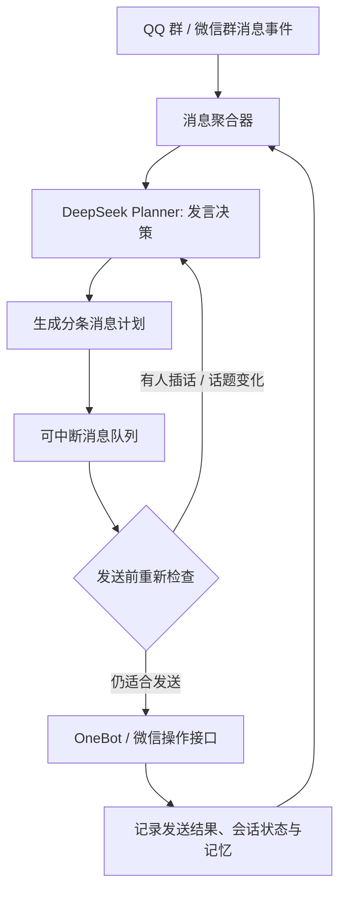

# QQ／微信 AI 真人式聊天：多段消息与自主连续发言实现机制

> 来源：本次 ChatGPT 网页对话中关于“那些 QQ AI 真人项目是如何做到能发送多段消息，而不是一问一答的？像真人一样”的答复整理。  
> 用途：供后续 DeepSeek Agent、QQ／微信机器人项目设计、Codex 阅读和实现参考。  
> 说明：文中的配置、流程示例及推荐参数要区分“项目文档已有能力”和“建议自行实现的架构”；不能直接视为现有项目的完整源码或已实测部署结果。

## 一、核心结论：两类机制

> 2026-10-25项目进度：已落地语义文字计划、持久待发队列、同一发言者短窗口聚合、插话后的未发尾部复核，以及可配置的独立延时重新评估。后台模型／工具／媒体理解按会话调度，收件循环继续读取新事件；完成结果先经过新收件扫描，未发文字与附件说明可复核，已接受前缀不改。独立文件／媒体保留自己的回执状态。并发、重启及混合媒体路径已增加回归测试，完整目标仍待原0–6最终运行审计，不能把本段当作整体完成声明。
>
> 第6条尚未整体完成：较长模型／工具调用仍需从主收件链路解耦，继续完成生成／下载期间插话及混合媒体调度回归，再按《目标1.md》0–6做当前状态审计。下文仍作为完整设计参考，不以本阶段队列改动宣称全部实现。

这些 QQ 真人 AI 项目能够像人一样**连续发送多条消息、主动补充、等待别人回复，甚至在没人直接提问时主动发言**，主要使用两种机制：

1. **消息分段发送（Segmented Reply）**：AI 先生成一段文本，程序把它拆分成多条 QQ 消息，并按间隔逐条发送。
2. **自主对话调度（Autonomous Conversation Agent）**：AI 决定是否发言、发几条、何时继续、何时停止，并根据群友的新消息调整后续行为。

第一种实现简单，但主要只是“外表像真人”；第二种才能更真实地摆脱一问一答模式。

之前讨论的项目中，**qq-bridge 的 `reserved2` 模式较接近第二种机制**；**AstrBot 提供相对开箱即用的分段回复配置**。

## 二、传统回复、简单分段和自主 Agent 的区别

假设群友问：

> 你们觉得这个新游戏怎么样？

### 1. 传统 AI：一次性回复

**AI：** 我觉得这个游戏整体不错，画面很精美，玩法也比较丰富，不过优化方面还有提升空间。

### 2. 简单分段：一次生成，拆成三条

**AI：** 我感觉挺好玩的  
**AI：** 就是这优化有点离谱  
**AI：** 昨天玩半小时闪退两次 😂

三条消息可能在同一次模型调用中已经全部生成，程序只是依次发送。

### 3. 自主 Agent：中途感知插话并调整

**AI：** 我昨天玩了下  
**AI：** 画面是真不错  
**群友：** 但是不是很吃配置？  
**AI：** 对，我3060跑着也有点卡  
**AI：** 得把阴影调低点

这里的区别是：**第三种需要接收新事件、重新规划和改变待发送内容**，不是简单字符串切割。

## 三、开源项目的实现思路对比

| 项目 | 多条发送机制 | 是否能自主继续发言 |
|---|---|---|
| [AstrBot](https://github.com/AstrBotDevs/AstrBot) | 正则切分 + 随机延迟 | 默认不具备完整自主社交 |
| [qq-bridge](https://github.com/Derpyu520/qq-bridge) `reserved` | AI 利用空格等标记分段 | 状态机控制参与和收尾 |
| qq-bridge `reserved2` | AI 主动调用 `qq_send_message`，可支持消息数组 | 可以通过工具主动读取、发送、等待 |
| [NimuQDock-dsh](https://github.com/NimuStudio/NimuQDock-dsh) | 回复长度切分 + `sendDelayMs` | 人格与参与评分驱动 |
| [MaiBot](https://github.com/Mai-with-u/MaiBot) | 发送管线和插件可支持多段消息 | Planner 和工具支持自主行为 |

### 3.1 AstrBot：分段发送最直接

AstrBot 的 `platform_settings.segmented_reply` 可配置分段回复，例如：

```json
{
  "enable": true,
  "only_llm_result": true,
  "interval_method": "random",
  "interval": "1.5,3.5",
  "words_count_threshold": 150
}
```

主要思路：

- AI 先生成完整回复。
- 程序按标点或其他分隔规则切成多段。
- 每隔 1.5～3.5 秒发送一条。
- 通过字数阈值等条件限制哪些回复启用切分。

**局限：** 消息生成时通常已确定后续内容；期间即使有群友插话，也不一定会重新规划待发送消息。

项目入口：[AstrBot GitHub](https://github.com/AstrBotDevs/AstrBot)

### 3.2 qq-bridge：AI 通过工具自己控制连续发言

`reserved2` 的关键设计不是直接转发模型输出文本，而是**让 Agent 用工具完成 QQ 通信**，例如：

- `qq_get_unread_messages`：获取未读消息。
- `qq_send_message`：发送消息，可以支持分条消息。
- `qq_reply`：引用真实消息回复。
- 等待、唤醒或潜水：选择下一次观察和行动的时机。

因此，在一次 Agent 执行中，AI 既可能多次发送消息，也可能接收新消息后再决定后续动作。

**注意：** 工具存在不等于每个场景都自动实现“发送前重规划”和“未发送消息取消”；这些仍取决于调度器、消息队列及具体模式。

项目入口：[qq-bridge GitHub](https://github.com/Derpyu520/qq-bridge)

### 3.3 MaiBot：语义分段而不是单纯按标点拆

相关插件：[Smart Segmentation Plugin](https://github.com/saberlights/smart_segmentation_plugin)

这类方法尝试让小型 LLM 判断：**真人在这段话的哪个位置可能主动按下发送键？**

例如原文：

> 我昨天本来打算玩一下，结果一玩就是三个小时，今天困死了哈哈。

可能分为：

1. 我昨天本来打算玩一下
2. 结果一玩就是三个小时
3. 今天困死了哈哈

这会比强制按每个标点切分更自然，也可以与模拟打字速度、发送延迟的逻辑结合。

项目入口：[MaiBot GitHub](https://github.com/Mai-with-u/MaiBot)

## 四、建议自行实现的架构

推荐采用**事件驱动的 Agent + 可中断消息队列 + 实时上下文感知**。



各模块职责：

1. **QQ／微信事件监听**：接收私聊、群聊、@、引用、图片、表情、时间戳等事件。
2. **消息聚合器**：短窗口聚合同一话题的消息，防止每来一句就机械回复。
3. **DeepSeek Planner**：综合话题、关系、近期状态，选择沉默、回复、主动提问、补充或等待。
4. **消息计划队列**：将一次发言安排为若干条消息，附带延迟、目标会话、可中断标记。
5. **发送前再检查**：发现群友新消息、话题变化、权限变化时暂停、修改或取消尚未发送内容。
6. **协议执行层**：通过 OneBot、微信自动化 API 或 MCP 实际发送，记录成功、失败和重试。

最重要的原则是：**将“生成回复”和“执行发送”分离**。

## 五、推荐的结构化消息计划

以下 JSON **是建议自行定义的数据协议，不是 qq-bridge 现有 API 的原样声明**：

```json
{
  "action": "send_messages",
  "target": "current_group",
  "messages": [
    {
      "type": "text",
      "content": "我昨天也玩了",
      "delay_ms": 800
    },
    {
      "type": "text",
      "content": "感觉画面确实不错",
      "delay_ms": 1700
    },
    {
      "type": "text",
      "content": "但是有点吃配置😂",
      "delay_ms": 2100
    }
  ],
  "interruptible": true,
  "wait_for_reply": true
}
```

必须强调：即使一次计划生成了三条消息，队列执行时也不应该保证将三条机械地全部发出，应根据新事件动态调整。

## 六、让聊天自然的关键：可打断发言

假设 AI 原计划连续发送两条：

> AI：其实我觉得这个游戏还行  
> （第二条仍在队列中）

此时群友问：

> 你玩的是端游还是手游？

如果仍继续发送原计划的第二条、第三条，就会显得非常机械。

更自然的实现：

1. 新消息事件到达。
2. 对当前会话中未发消息的队列设置**暂停**或**待重新检查**。
3. 判断新消息与当前话题的相关性、对原发言是否造成语义冲突。
4. 选择继续、修改、重新生成或取消剩余消息。
5. 更新会话状态，并设定下一次可行动时间。

对于必须按序交付的文件、工具执行结果等，应有独立的、不可随意取消的任务类型，不能一刀切地全部打断。

### 推荐初始测试参数

以下是**开发调试起点，并非上述各项目统一采用的实际默认值**。

| 参数 | 推荐初始值 |
|---|---|
| 消息聚合等待 | 2～4 秒 |
| 常规连续发送间隔 | 0.8～2.5 秒 |
| 长消息间隔 | 2～5 秒 |
| 单次连续消息数量 | 1～4 条 |
| 连续发言后冷却 | 15～45 秒 |
| 新消息打断 | 开启 |
| 无人发言主动插话 | 默认关闭，在测试群按需启用 |
| 发送频率限制 | 分群、好友、账号分别设置 |
| 高风险操作 | 人工审批 |

**不要让 AI 固定每次都发三四条。** 真人交流中，一字回复、表情、连续补充或沉默都是自然现象；真正的自然度来自上下文与选择，而非随机延迟的数值本身。

## 七、最终建议：六项必需能力

推荐吸收以下项目的设计思路（**并不意味着三个项目已具备可以直接拼装的官方集成方案**）：

- **MaiBot**：自发表达、规划、语义切分。
- **qq-bridge `reserved2`**：模型自主调用 QQ 读取、发送等工具。
- **自建调度器**：可取消、可暂停、可按新消息重规划的消息队列。

最终系统应具备：

1. **语义分段**：根据内容决定何处“按下发送”，而不仅按标点切分。
2. **主动连续发言**：一次决策可安排多条，或者在多轮 Agent 决策中继续发言。
3. **实时上下文感知**：发送期间持续监听对话事件。
4. **可打断消息队列**：对尚未发送内容进行暂停、修改、取消。
5. **独立唤醒机制**：允许后续重新评估话题，而不是必须等待被明确提问。
6. **参与意愿与长期记忆**：结合当前话题、人员关系、近期发言强度选择回复或沉默。

## 八、一句话总结

> **让 AI 像真人聊天的关键，不是让提示词要求“把回复分成三段”，而是将 DeepSeek 设计为一个能持续观察、主动决策、多次发送、可被新消息打断的事件驱动 Agent。**

## 九、相关项目链接

- AstrBot：<https://github.com/AstrBotDevs/AstrBot>
- qq-bridge：<https://github.com/Derpyu520/qq-bridge>
- NimuQDock-dsh：<https://github.com/NimuStudio/NimuQDock-dsh>
- MaiBot：<https://github.com/Mai-with-u/MaiBot>
- Smart Segmentation Plugin：<https://github.com/saberlights/smart_segmentation_plugin>

---

*文档记录的是对话中的技术分析和实现建议；涉及具体版本、配置字段、插件支持情况，应在实际开发时核对所安装版本的 README、配置 schema 与源代码。*
