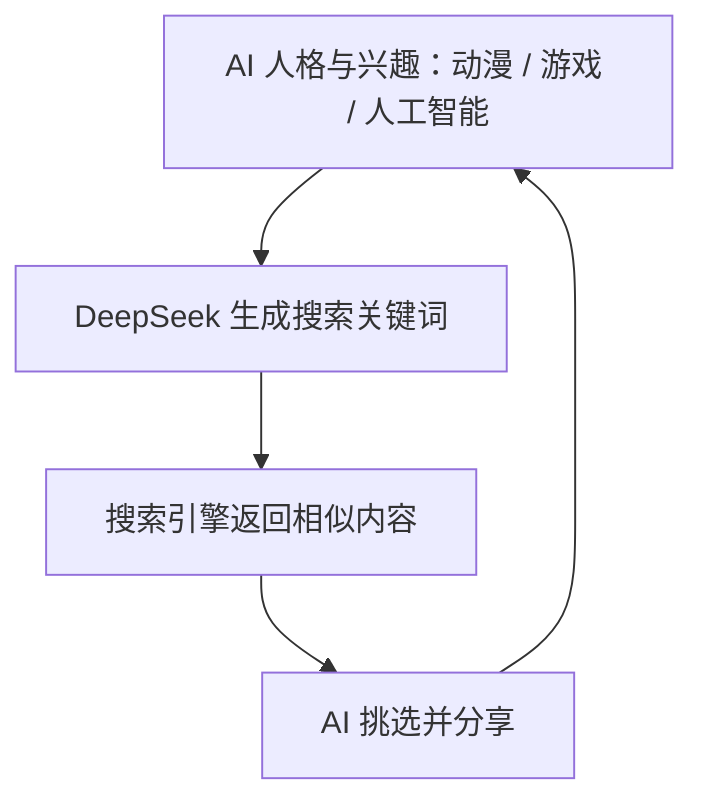
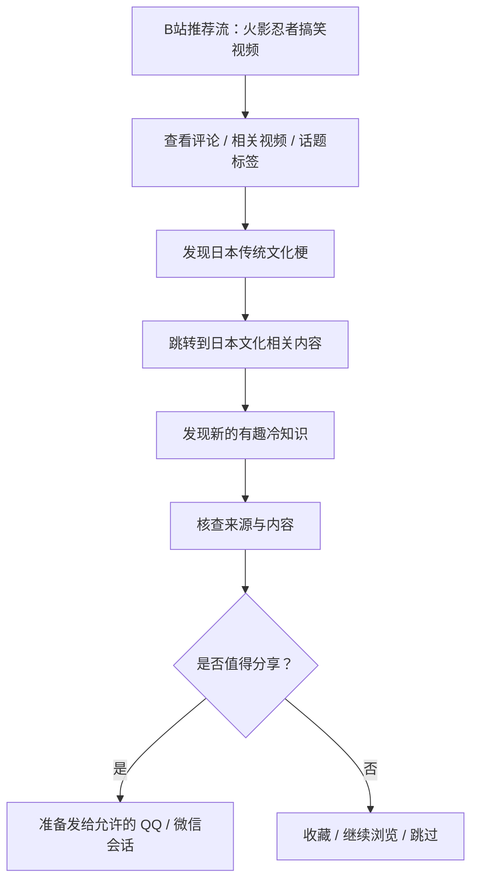
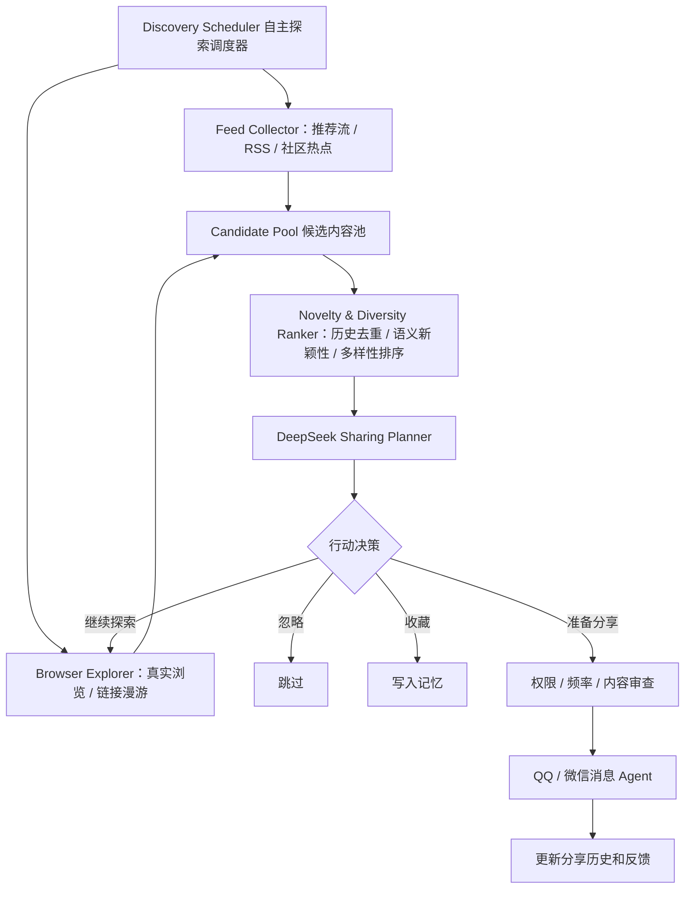

# QQ／微信 AI Agent 自主网上冲浪：多源内容发现、兴趣漫游与智能分享方案

> 来源：本次 ChatGPT 对话中关于“AI 目前主要依靠搜索引擎，导致每次返回相同主题，如何实现网上冲浪后遇到有意思的内容再分享”的完整回复整理。
>
> 用途：可供 Codex、DeepSeek 或其他 Agent 作为需求与方案文档读取。方案中的策略权重、阈值与代码为设计建议／示例，并非已经完成的项目实现或经实测的最优值。

## 本项目落地说明（2026-10-25）

现有Go项目已按本方案加入一个有界的多源发现实现。下文保留为整体设计参考；此处区分已经实现与后续扩展，避免把示例架构当成当前能力。

- **发现入口**：每轮先读取公开推荐／热门列表、RSS／Atom订阅、音乐目录与每日图片，形成候选池；由模型选择深入具体内容、关联探索、收藏或不分享。当前内置B站热门／音乐榜、必应每日图片、少数派及公开器乐目录，维基共享图片作为可选源。来源实际失败仍显示失败，不绕过登录、验证码或访问限制。
- **音乐、视频、图片**：音乐取得真实音频后准备试听语音，保留原文件用于改发音频文件；短视频准备附件，超过60秒优先准备实际播放页卡片；图片必须取得真实图片数据。标题／简介只是元数据，不能据此声称完整看过或听过。
- **持久记录**：私有 `surf-history.json` 保存浏览会话、候选、访问、收藏、具体来源失败、选择结果及分享对象与时间。仅微信接受后的分享进入已分享记录；旧日志中已接受的冲浪分享可导入去重，不会因此补发或刷新原发送时间。此记录与QQ／微信接入协议分离，目前实际接入仍是微信。
- **去重与多样性**：URL规范化、标题／引用标题相似度、近期已分享主题、模型结合会话上下文共同判断；候选按来源及形式分散选择，浏览过的候选短期避开，同主题分享默认冷却7天。未部署Embedding服务，也不宣称拥有完整的向量语义检索或经实测最优的MMR权重。
- **关联探索**：目前实际接入B站公开BV相关推荐，可从本轮候选或以前收藏／访问过的BV继续漫游；默认最多2层。RSSHub、Miniflux可通过公开RSS／Atom地址接入；没有安装其独立服务，也没有安装Browser Use。需要登录或执行JavaScript的通用网页浏览仍属于后续可扩展MCP能力。
- **网页配置**：AI网上冲浪→自主冲浪设置→内容发现与去重，可设置来源开关、公开订阅、入口权重、同主题冷却、单轮来源数及关联深度。权重是来源偏好与模型探索方向，不保证每种平台都有个性化推荐流；某类不可用时回退其他来源。总工具调用预算沿用联网设置，来源读取也计入工具预算。
- **安静与频率**：原随机间隔、每日浏览预算、目标白名单、发送权限和Agent安静时段继续生效。安静时段不启动、不扣次数；浏览不等于必须分享。网页“浏览轨迹与收藏”手动刷新，不在查看时自动跳到顶部。

代码入口：`internal/mcptools/discovery.go`、`internal/admin/surf_discovery.go`、`internal/admin/surf.go`、`internal/companion/tools.go`、`internal/admin/static/surf.js`。真实公网与模型测试使用隔离记忆和模拟微信发送端，不向群里发送测试内容。

## 核心结论

当前问题更像是**内容发现机制**的瓶颈，而不只是搜索质量问题：**AI 会搜索信息，但不会真正地“逛互联网”。**

例如，Agent 每天搜索“AI 新闻”“有趣的动漫内容”“游戏趣闻”，虽然搜索结果更新，但话题始终围绕少数关键词打转。而真人可能从游戏视频跳转到动物视频，再从评论区发现梗，最终看到有意思的历史故事并转发给朋友。

这一类发现过程可称为 **Serendipitous Discovery（意外发现／偶遇式内容发现）**。

推荐将现有的 **搜索驱动 Agent** 改造为：

**推荐流 + 多平台内容源 + 兴趣漫游 + 关联探索 + 新颖性筛选 + 分享决策**。

---

## 一、为什么当前实现总是搜到相同主题？

假设当前执行链路如下：



这里存在三个根本问题：

1. **入口太单一**：搜索引擎只能回答 AI 已经想到的问题，很难发现它尚不知道的话题。
2. **兴趣正反馈循环**：今天喜欢动漫就搜动漫，明天根据昨天结果继续搜动漫，探索范围逐渐收缩。
3. **缺少探索历史**：如果系统不记录浏览过、搜索过、分享过的主题，就很难确认内容是否真的新鲜。

尤其要注意：**URL 不同，不代表话题不同。** 十家网站报道同一件事，仅靠 URL 去重仍会反复分享同一话题。

因此，真正要调整的是**内容发现与调度系统**，不只是 DeepSeek 的提示词。

---

## 二、推荐方案：建立五种内容发现入口

不要再让 DeepSeek 在每个循环里先生成搜索词。应该让系统从不同渠道收集候选内容，再由 DeepSeek 决定哪些值得深入浏览。

以下比例为建议初始值，可通过实际运行效果调整：

| 发现方式 | 初始比例 | 作用 | 示例 |
|---|---:|---|---|
| **推荐流探索** | **30%** | 进入 B 站首页、社区推荐页、资讯推荐流，浏览平台推送内容 | 意外刷到未打算搜索的有趣视频 |
| **社区热点** | **25%** | 从社区最新、热门、上升内容采样，并轮换分区 | 从科技话题跳到生活趣事 |
| **兴趣订阅** | **20%** | 查看关注创作者、网站、论坛板块、RSS 更新 | 关注的 UP 主发布新视频 |
| **关联漫游** | **20%** | 顺着相关推荐、引用链接、帖子与评论继续探索 | 从游戏视频评论中发现冷知识 |
| **主动搜索** | **5%** | 验证信息、深入研究、定位资料时才使用搜索引擎 | 核实刚看到的科技消息 |

这样即使 AI 原本人格设定偏爱动漫和游戏，也会有机会发现动物、旅游、历史、科学、搞笑等不同主题。

### 可接入的开源工具和内容入口

| 工具 | 用途 | 推荐程度 | 链接 |
|---|---|---|---|
| **RSSHub** | 聚合 B 站、微博、知乎等站点的可用内容源 | 很高 | https://github.com/DIYgod/RSSHub |
| **Miniflux** | 管理 RSS 订阅、更新游标、未读条目 | 很高 | https://miniflux.app/docs/api.html |
| **Browser Use** | 真实浏览网页、滚动推荐流、探索关联内容 | 很高 | https://github.com/browser-use/browser-use |
| **Hacker News API** | 获取科技社区热门、最新、最佳、Show HN 内容 | 高 | https://github.com/HackerNews/API |
| **Mastodon API** | 读取公开时间线、热门帖子和标签 | 可选 | https://docs.joinmastodon.org/methods/timelines/ |

实践说明：

- RSSHub 有 B 站排行榜等路由，但部分站点路由可能随平台更新而失效。
- Miniflux 提供 REST API，适合作为候选内容池的数据来源。
- Hacker News API 的 `topstories`、`newstories`、`beststories` 和 `showstories` 可直接提供非关键词搜索入口。
- Mastodon 的时间线接口存在实例权限限制。

**不要把 RSS 当成全部解决方案。** 如果始终只订阅固定账号，仍可能形成信息茧房。更重要的是允许 Agent 从当前内容不断发现新的相关主题和内容来源。

---

## 三、核心功能：关联漫游（Content Rabbit Hole）

假设 AI 从 B 站首页看见一个《火影忍者》搞笑视频：



这个功能的实现重点是 **Browsing Session（浏览会话）**。每次会话保留当前入口、已访问内容、探索层级与资源预算，而不是每次重置为一条独立的搜索命令。

### 浏览会话结构示例

```json
{
  "session_id": "browse-001",
  "entry_mode": "recommendation_feed",
  "current_platform": "bilibili",
  "current_topic": "动漫",
  "visited_urls": [],
  "discovered_topics": [],
  "exploration_depth": 0,
  "max_depth": 5,
  "remaining_actions": 20,
  "remaining_model_calls": 8
}
```

解释：

- `max_depth`：允许从最初内容向外跳转的最大层数。
- `remaining_actions`：网页操作次数预算。
- `remaining_model_calls`：模型调用预算，防止长时间无边界执行。

每次遇到新帖子、视频或链接，让 DeepSeek 做三类决策：

1. **继续探索**：当前内容值得追踪，打开相关推荐、引用或评论中的线索。
2. **切换内容**：当前内容价值较低，返回推荐流、换分区或换来源。
3. **收藏并结束**：发现值得分享的内容，先保存候选信息并结束本轮浏览。

核心变化：**不再反复向 DeepSeek 提问“接下来搜索什么关键词”，而是让它基于当前所见内容选择下一步。**

---

## 四、建立内容新颖性记忆，避免重复浏览和分享

即使使用多来源内容发现，如果没有浏览记忆，依然会重复推荐。

至少保存三层信息：

| 记忆类型 | 保存内容 | 目的 |
|---|---|---|
| **浏览记录** | URL、平台、标题、浏览时间 | 不反复打开同一内容 |
| **主题记忆** | 主题摘要、关键词、向量表示 | 不反复探索高度相似的话题 |
| **分享记录** | 分享对象、主题、时间、反馈 | 不向同一好友重复分享相似内容 |

例如 AI 最近分享过“RTX 5090 显卡性能”，今天又从不同网站刷到三篇讲同一评测的文章。URL 虽不同，也应识别为同一或高度相似的话题；只有新增实质信息时才考虑再次分享。

### Embedding + MMR 多样性重排

建议使用 **Embedding（语义向量）+ MMR（Maximal Marginal Relevance，最大边际相关性）**，同时平衡候选内容与兴趣的相关性、历史新颖性及本轮候选之间的差异。

一个可供实验的评分函数：

\[
S=0.25I+0.25N+0.20F+0.15D+0.15Q
\]

其中：

- **I**：兴趣匹配程度。
- **N**：相对历史浏览与分享记录的新颖性。
- **F**：趣味性与潜在分享价值。
- **D**：相对同批候选内容的多样性。
- **Q**：可信度与信息质量。

这些权重只是**初始实验配置**，并非经过验证的最优值。排序前还应对重复、失效、过期、低可信内容做硬过滤；语义去重阈值应基于真实数据校准，避免把同主题下的新进展误删。

参考：OpenSearch 对 MMR 的说明：https://opensearch.org/blog/introducing-mmr-vector-search/

---

## 五、分开处理“觉得有趣”和“值得分享”

目标不是打造一个不停推送新闻的机器人，而是让 AI 允许自己“看看就算了”。

### 示例决策过程

1. **发现内容**：有人拍到猫模仿人坐电梯的视频。
2. **判断是否有趣**：与近期反复浏览的 AI／游戏内容不同，新鲜且有趣。
3. **判断是否适合分享**：目标 QQ 群正在讨论轻松话题，最近没有分享过相似内容。
4. **准备分享**：生成简短自然的分享文本，附原始链接。例如“哈哈刚刷到这个猫坐电梯的视频，有点好笑 😂”。

**即使内容有趣，也可以只收藏、不分享。** 否则只是把“重复搜索”变成“向群里大量发链接”。

建议测试期针对**明确授权的测试群**，初期每群每天最多主动分享 **1～2 条**，同时使用冷却时间、频率限制和人工审查策略。对不熟悉的好友或高敏感场景，使用待审核分享队列。

---

## 六、推荐整体架构



最重要的架构原则是：**不要让 DeepSeek 每次从零决定整个探索过程。**

- **调度器**：负责来源多样化与资源预算。
- **工具**：负责收集内容、浏览页面。
- **数据库**：负责长期记录、去重与分享历史。
- **DeepSeek**：负责内容理解、趣味性判断和下一步选择。
- **QQ／微信 Agent**：只在有权限的对象和允许的频率下实施分享。

### 第一版可执行逻辑（架构伪代码）

```python
def autonomous_browse():
    # 1. 按探索策略抽样，而不是默认调用搜索
    strategy = sample_strategy({
        "recommendations": 0.30,
        "community_trending": 0.25,
        "subscriptions": 0.20,
        "related_content": 0.20,
        "search": 0.05
    })

    # 2. 收集候选内容
    candidates = discover(strategy)

    # 3. 过滤浏览过、分享过和语义重复的内容
    candidates = novelty_filter(
        candidates,
        browse_history,
        share_history
    )

    # 4. 兼顾趣味性、质量与主题多样性
    ranked = diversity_rank(candidates)

    # 5. DeepSeek 决定下一步行为
    decision = deepseek_decide(ranked)

    if decision.action == "explore":
        enqueue_related_exploration(decision.url)

    elif decision.action == "bookmark":
        save_to_memory(decision.content)

    elif decision.action == "share":
        enqueue_share_for_policy_check(decision.content)

    # 6. 保存本轮探索状态
    persist_session()
```

> 注意：上面是**架构伪代码**，不是可直接运行的完整 Python 程序。需连接现有的搜索、RSS、浏览器、数据库、模型和 QQ／微信工具。

---

## 七、建议优先改造的模块

不需要推倒已有 QQ／微信 DeepSeek Agent，也不必立刻部署完整 OpenClaw。

| 优先级 | 改造内容 | 预期收益 |
|---|---|---|
| **P0** | 搜索入口改为多源候选发现 | 减少来源单一 |
| **P0** | 增加已浏览／已分享主题数据库 | 减少重复浏览、重复分享 |
| **P1** | 增加推荐流和相关推荐跳转 | 实现探索式冲浪 |
| **P1** | 增加新颖性、多样性重排 | 降低主题长期集中 |
| **P2** | 兴趣演化与随机探索 | 让浏览方向自然变化 |
| **P2** | 浏览和分享反馈机制 | 持续优化内容选择 |

如果 QQ 和微信未来共用同一个 Agent 人格、长期记忆，那么**浏览历史与分享历史应放到共享记忆层**，而非各平台各保存一份。

### Web 管理后台推荐配置项

建议后台提供：

- 推荐流权重。
- 社区热点权重。
- 订阅源权重。
- 关联探索权重。
- 搜索权重。
- 陌生主题探索概率。
- 重复主题冷却天数。
- 已浏览／已分享内容检查。
- 单次浏览操作／模型调用预算。
- 分享队列、人工审批与分享频率限制。

一份默认配置：

```json
{
  "discovery_weights": {
    "recommendations": 30,
    "community_trending": 25,
    "subscriptions": 20,
    "related_content": 20,
    "search": 5
  },
  "weight_normalization": "normalize_to_sum_1",
  "unfamiliar_topic_probability": 0.20,
  "topic_cooldown_days": 7
}
```

这些参数均为交互示例的建议起点，**不会自动改动实际 Agent**。如果用户在网页中调整权重导致总和不是 100，调度器需要将有效权重归一化；不能在出现负数时直接作为采样概率。

---

## 最终建议

目前最值得改进的不是增强 DeepSeek 搜索能力，而是让它能够**在没有明确搜索目标时发现内容**。

第一版优先组合：

**RSSHub + Miniflux + B站／社区推荐流 + Browser Use + DeepSeek + 内容新颖性记忆**。

各模块职责：

- **RSSHub／Miniflux**：收集新内容。
- **Browser Use**：浏览网页、顺着内容关联探索。
- **DeepSeek**：判断内容价值、趣味性与后续行为。
- **数据库**：记录浏览、主题发现、已分享内容。
- **现有 QQ／微信 Agent**：在适合的上下文与权限下分享。

最后一个关键原则是：**不要强制 AI 每次冲浪都找到值得分享的内容。** 大多数情况下可以只浏览、跳过或收藏；偶尔发现特别有意思的内容，才准备分享。

若后续提供现有搜索、浏览和内容分享代码／Agent Skill／Prompt，就可以在保留现有系统的情况下，针对性加入多源发现、关联漫游、语义去重与分享决策。

---

## 参考资源与延伸阅读

- RSSHub：https://github.com/DIYgod/RSSHub
- RSSHub B 站相关路由：https://docs.rsshub.app/routes/social-media#bilibili
- Miniflux API：https://miniflux.app/docs/api.html
- Browser Use：https://github.com/browser-use/browser-use
- Hacker News API：https://github.com/HackerNews/API
- Mastodon 时间线 API：https://docs.joinmastodon.org/methods/timelines/
- OpenSearch MMR：https://opensearch.org/blog/introducing-mmr-vector-search/

> 技术依据与链接整理自对话中此前提供的资料；开源项目能力和 API 可用性可能随版本变化，正式集成前应再次核验。
