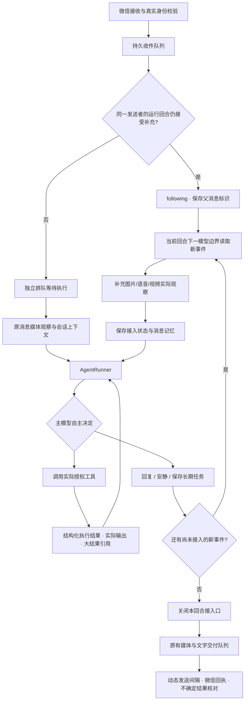

# Agent 会话执行内核（0.25.0）

这轮改造独立实现会话运行时和能力适配结构，参考 AstrBot 的执行循环与 follow-up 设计思路，没有复制其 AGPL 源码，也没有引入 AstrBot/OpenClaw 服务或新的 Python 环境。

## 本轮实际变化

普通微信会话使用一个 `AgentRunner` 执行“模型 → 工具 → 真实反馈 → 模型”循环。后台收到同一账号、同一会话、同一真实发送者的可处理消息后，会将其挂到当前运行回合，而不是一边另起模型判断是否取消旧任务、一边让新消息以后再回复一次。

新消息到达模型请求期间，尚未执行的旧答案会被丢弃，模型结合新事件重新决定；先前已经完成的工具结果保留。新消息到达执行前回应的随机等待或回执等待期间，也会在调用业务工具前重新判断。已经进入工具的调用仍遵守该工具的取消和超时语义，不承诺可以撤销外部副作用。

不同群、不同发送者的消息不会共享当前请求者身份。群成员不能通过插话取得主人的服务器或跨群权限。新事件只包含安全的正文/消息标识；图片等从原生消息接口重新读取并验证身份后，才调用实际媒体理解，原始附件 XML 和密钥不进入模型事件。引用回复保留已有引用上下文。

## 持久状态和重启

`messages-v2.json` 保持 version=1，新增可选 `followup_parent`、`followup_consumed` 和 `following` 阶段，兼容已有收件和发送数据。

- 接入的补充消息完成后，逐条标记 `completed`，保留父消息关联；它不会再独立触发一轮回复。这里表示模型处理结束，**不表示微信已送达**。
- 尚未接入或原回合在任何工具执行之前失败的消息恢复为 `received`，可以重新处理。
- 回合已执行工具但在重启时结果不明，已接入的消息保留为 `interrupted`，沿用现有任务检查点和副作用核对机制；不会直接重跑可能已完成的命令或发送。未知发送仍由原生发送账本核对。
- 媒体尚未读完时，短说明不会触发另一个“取消旧任务”模型。普通实时会话不再调用该额外审查；已排队但尚未发出的文字尾部仍保留原有复核机制。
- 原任务已关闭接入口后到来的消息属于下一回合；已排队的旧回复会按已有的新消息复核机制处理。

## 能力适配和上下文

`internal/admin/capabilities.go` 集中注册 Agent/工作区/微信、手机、插件后台任务、百炼、YuE、工具输出读取模块。每个模块同时提供发现和调用处理。统一入口继续先核对实时权限和 JSON 参数，再交给模块；外部 MCP/API 插件继续使用原有运行时，不能直接安装 AstrBot Python 插件。

工具调用反馈增加 `execution.status`（succeeded/failed/blocked）、执行耗时、失败说明及大结果编号。原始业务结果仍在 `result` 中，提交任务、工具成功和微信接受各有各的证据；原生 function calling 的 `tool` 消息会保留这些字段。

较大的结果写入管理私有目录 `tool-outputs/<账号-会话-发送者哈希>/`，模型先看到预览和 `result_id`，可用 `tool_output_read` 分页读取。最多保留单条 1MiB 的有效 UTF-8 输出，七天后不可读取，并在后续写入时清理本范围过期文件。预览和分页都有字节边界，中文分页不会因截断跳过正文。读取时重新检查原工具权限；不接受任意路径，不能读取其他群或其他用户的结果，预览模式不能访问真实结果。这些文件加入 Git 忽略和仓库检查禁入列表。

长行动上下文压缩保留完整的工具调用/结果配对，以及最近一批结构化补充事件。最新“改发文件”等要求不会因压缩退回最初的语音要求。原有长期 Markdown 工作区、任务数据库、记忆摘要继续分工使用；按需发现工具、读取文档，无需把所有项目文件塞入提示词。

## 保留的边界

这次没有重写微信协议、发送账本、YuE 生成器、语音编码器，也没有删除所有业务校验。真实素材、可验证下载来源、参数格式、身份权限及未知副作用核对仍保留。自主模式原有的无工具调用次数配额保持不变，单个回合取消/截止时间和各工具自身超时继续生效。

自主冲浪、主动问候和持久任务续办没有套用“同一发言者即时补充”的接入方式，因为它们没有同样的当前用户发言语义。它们继续通过同一个模型/工具循环执行，并使用现有的任务和分享策略。

## 验证方式

新增回归覆盖事件身份、去重、接入/关闭竞争、图片加说明、处理中追加图片、丢弃过期草稿而不重放已执行工具、另一发送者独立排队、重启恢复、工具失败反馈、适配器超时、长上下文配对、大输出中文分页和隔离读取。使用合成消息、假工具和假微信传输，不把这些测试称为真实群收发验收。

本机真实模型验证只使用独立预览内存、合成消息与只读假工具，不发送微信消息、不读取真实群历史。交付时另行记录源码检查、实际模型和本机服务状态的结果；音乐音色、手机播放及真实群并发体验仍需实际使用验证。

2026-10-27 本机验收：`go test ./...`、`go vet ./...`、命令构建、静态 JavaScript 语法检查通过；新增会话队列、Runner 和机器人补充消息回归通过 `-race`。真实模型使用一次假文档读取，执行中接入“只回复海盐汽水”，最终准确回复且没有重复读取。可选复测通过 `WECHAT_AGENT_LIVE_SESSION_CONFIG` 指向私有 `admin/config.json` 后运行 `TestLiveModelSessionFollowup`；同目录 `provider-key` 仅在本机读取，测试会产生模型 API 费用，不执行真实微信发送。

本机后台更新至 `0.25.0-agent-session-local`，检查到机器人运行、微信连接在线；更新脚本确认原配置哈希不变，未重启原生协议服务。另修正 Windows 启动脚本：WSL 冷启动时等待原生 API 就绪，再查询已保存的登录，避免进程已启动但 API 尚未监听就报错。
