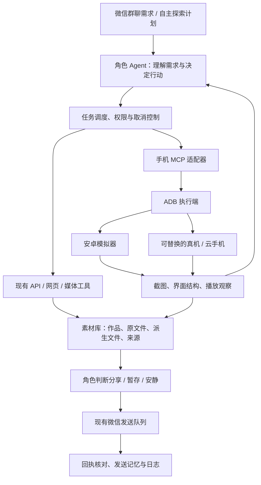

# 大肥鱼：微信后台与手机 Agent 结合方案

状态：2026-10-26 的设计方案。用户认可两者结合，暂不以服务器规格约束设计；这是分阶段设计；当前实现与真实验证见 [手机工作台](mobile-workbench.md)，不代表已接管目标 App 账号。

## 目标与分工

保留现有微信消息接收、发送、群规则、角色、记忆、权限和媒体任务队列，增加可替换的手机操作插件。AI 能实际进入应用观察、浏览、搜索和取得内容，再根据真实观察决定是否分享。

| 路径 | 优势 | 局限 | 用途 |
| --- | --- | --- | --- |
| 现有后台 API、网页与媒体读取工具 | 消息身份清楚，可持久化排队，通常比逐屏点击节省调用 | 每类消息与媒体格式都需适配；网站接口会变化 | 微信收发、群聊理解、文件处理、视频号读取等已有链路 |
| 安卓模拟器上的 GUI Agent | 可进入真实应用界面，观察推荐流、字幕和评论 | 应用安装、登录、ABI、播放和自动化兼容性需要逐项实测；界面变化会导致失败 | 首轮手机操作验证，抖音等应用浏览 |
| 真机或云手机上的同一插件 | 可以复用同一任务与工具协议 | 设备连接、授权和可用性仍需管理 | 作为后续替换的执行端 |

路由优先使用已有可靠能力；需要进入应用界面时，再交给手机工具。界面操作不保证比后台接口更完整。例如，表情包漏记首先应修复消息类型与附件读取，不能仅靠切换到模拟器解决。

## 架构

大肥鱼的角色与长期记忆保持统一。手机执行模型只得到当前设备任务所需的有限上下文，不接收整段群聊历史、全部插件说明或其他会话的私人消息。

## 模拟器选择与首轮验证

首选用 Android Emulator / AVD 做可重复的开发验证，通过 ADB 接入。它支持独立设备状态、截图与输入等能力；正式决定前必须验证目标应用，不能根据开发模拟器可启动就推断抖音可正常登录与播放。

需要检查的项目：

1. 主机虚拟化、图形加速与已有 WSL / Hyper-V 环境兼容。
2. 目标应用能安装、启动、登录，所选镜像 ABI 与应用兼容。
3. 视频正常播放，能取得实际画面与可用音轨。
4. 弹窗、返回、搜索、分享菜单、保存本地均有可核实的结果。
5. 断线重连后保留应用数据；不把快照恢复当作消息发送的回滚手段。

若目标应用在 AVD 上不适配，再评估其他安卓执行端。管理后台、任务和素材协议不随设备替换而重写。当前阶段不安装第三方模拟器、不修改账号登录、不构建镜像。

## 工具与模型接入

优先评估 mobile-mcp 的现有能力，封装为项目设备插件；Open-AutoGLM 和 MobileAgent 用作专用手机操作模型/执行循环的候选。以下是项目拟定的能力分类，不是这些项目现有工具名称的逐字映射：

| 能力 | 输入与结果约束 |
| --- | --- |
| 查看设备与应用状态 | 返回已登记设备与允许应用；不暴露任意设备连接地址 |
| 观察页面 | 返回截图素材 ID、界面节点及快照版本，标记哪些信息实际取得 |
| 点击、滑动、输入、返回 | 动作绑定设备、当前任务、应用与快照版本；页面变化后重新观察 |
| 等待与播放观察 | 有时长上限，采集多帧及可用音轨；记录覆盖范围 |
| 保存媒体 / 取得分享链接 | 取得实际结果后返回素材 ID 或作品链接，不接受模型虚构的本地路径 |
| 暂停 / 取消 | 立即阻止尚未执行的动作；已执行动作如实记录 |

工具通过结构化参数调用。先给模型提供能力索引，按需发现具体工具；避免把每个插件的全部文档放进每轮对话。普通聊天人格仍由角色模型管理，复杂 GUI 操作可委托专用模型。

## 调度与中断

- 每台设备同一时刻只有一个前台操作任务，使用可续期租约；多个群聊不能同时抢点同一个屏幕。
- 长任务与微信接收循环分离，新消息照常进入持久化队列。
- 用户更换需求、要求停止、指定发送文件时，角色模型复核当前任务，取消未执行动作和未发送分段。
- 检查点记录最近已验证页面、已执行动作、已取得作品与素材。重启后重新观察设备，不能机械重放点击、点赞、评论或发送。
- 弹窗、加载中、网络错误应有有限恢复次数与任务时限。无法确认页面或结果时停止该步骤，保留明确失败状态。
- 自主浏览遵循安静时段、预算、目标群配置和重复内容记录；浏览与是否分享分别决定。

## 观看、下载与记忆

必须区分：看到封面、读到标题、观察视频部分画面、听到/转写音轨、取得完整媒体。这些不能互相代替。

1. 每条作品记录平台、可核实的作品标识/链接、作者与标题、观察时间、画面采样范围、音轨状态及读取失败原因。
2. 允许保存时通过应用实际保存或已有下载能力取得文件，核对大小、格式与时长。录屏标为录屏，不能标作原视频下载。
3. 对分享内容做作品标识、规范链接、文件哈希和语义近似去重，避免同一作品换标题后重复发送。
4. 原始文件、裁剪视频、截图、转写、语音分段和微信群发送回执通过素材关系关联。
5. “把刚才原视频发我”“换成文件”“上一首歌”优先解析本会话最近的关联作品；缺少原件时说明，不检索无关旧话题冒充原件。
6. 取得或发送媒体成功后再发完成说明。未完成时的进度回应要明确是在处理，不能提前声称已交付。

对微信表情包同样保留消息身份、发言者和原始时间：区分文字内置表情与独立 type=47 表情包；独立表情包先下载和识图，GIF 记录实际抽帧范围。视觉读取失败应保留“收到但未读懂”的事实，不能补造情绪或文字。

## 权限与网页管理

在现有“工具与权限”增加设备插件配置，避免再建一套互相冲突的权限系统：

- 登记设备、允许应用、允许查看截图/界面、搜索和浏览。
- 下载、录屏、跨应用跳转分别设置权限。
- 微信分享复用现有按群/私信目标、媒体类型的发送权限。
- 点赞、收藏、关注、评论、发布分别授权，不因允许浏览而默认获得。
- 账号设置、支付等动作默认不可执行，需要明确的额外权限与适用范围。
- 截图、下载文件、登录状态属于本地私有数据，不进入 Git；连接凭据通过私有配置保存。

“AI 网上冲浪”继续作为统一查看入口：显示来自 API、网页或手机的浏览记录、实际观察、素材状态、分享决定和失败原因。可查看当前设备截图与任务并手动暂停。日志无需刷新到顶部；截图应按权限取用，不向群聊自动泄露整屏私人信息。

## 实施与验收顺序

| 阶段 | 交付 | 验收条件 |
| --- | --- | --- |
| 0：补齐消息理解 | 表情包接收、视觉观察和记忆，保留失败事实 | 收到的表情包不再被当作通用非文字消息丢弃；模拟静态图/GIF、权限与失败测试通过；实际附件另行验证 |
| 1：设备观察 | 一个模拟器的状态、截图、节点、单步操作 | 真实目标应用能登录和播放；网页可查看实际截图；不向群发送 |
| 2：受控探索 | 搜索与少量视频浏览、内容理解、取得截图或媒体 | 各作品均有可验证来源和观察范围；可取消；失败不会变成虚构成功 |
| 3：接入角色 | 需求驱动浏览、自主兴趣、安静/分享判断与去重 | 能根据新需求切换任务；安静时间内不启动自主浏览；相同作品不重复分享 |
| 4：实际分享 | 调用现有微信发送、引用、间隔、回执与记忆 | 取得授权后在指定测试群验证；服务接受与手机实际播放分别确认 |

先实现最小完整链路，再扩展评论阅读、跨应用等能力。方案中的手机能力均须按上述阶段验证，不能将开源 README 或一次截图当作已交付的持续运行能力。

## 参考资料

- Android Emulator：https://developer.android.com/studio/run/emulator
- Android 硬件加速：https://developer.android.com/studio/run/emulator-acceleration
- mobile-mcp：https://github.com/mobile-next/mobile-mcp
- Open-AutoGLM：https://github.com/zai-org/Open-AutoGLM
- MobileAgent：https://github.com/X-PLUG/MobileAgent
- scrcpy 录制：https://github.com/Genymobile/scrcpy/blob/master/doc/recording.md
