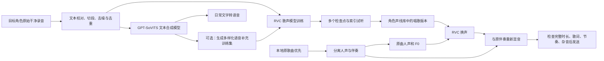

# 角色声线：训练、说话、翻唱的组合方案

结论：GPT-SoVITS 与 RVC 可以组成同一条角色声音工作流，但需要各自匹配的模型。
GPT-SoVITS 的 GPT/SoVITS 权重不能直接重命名为 RVC 权重使用。

## 推荐实施顺序

1. 先跑通目标音色的 GPT-SoVITS 短句，确认文字正确、声音接近，再决定是否扩大素材生产。逐声线验证结果保存在账号私人库；听感仍由使用者确认。
2. 优先寻找原始训练录音。已有训练权重不等于原始素材仍在；若只有短参考录音，应明确记录素材缺口。
3. 原始材料不足时，可用 GPT-SoVITS 合成不同音素、语气、速度的文本，清洗后作为 RVC 训练补充。不能反复复制一句话凑时长，不能把合成的电音、鼻音和异常音当作训练目标。原始干净的歌声素材对覆盖唱歌音域尤其有帮助。
4. RVC 官方建议至少约十分钟低噪声语音作为训练起点。这是数据建议，不是本项目的能力上限；最终选择依据验证片段和试听结果。前期做短片段 A/B 比较，确认收益后再训练完整模型。
5. 将 RVC `.pth` 和检索 `.index` 登记为该角色的独立唱歌版本。默认参数可以调整；训练集、模型、seed、epoch、采样率、F0 范围及试听结论应一并保留。一次训练成功后可复用模型，不需要每首歌重训。
6. 翻唱时使用原歌曲的人声经 RVC 换声，保留原词、演唱节奏和伴奏。不要先让 GPT-SoVITS 把歌词朗读一遍再把它称为原曲翻唱。YuE 用于重新创作或参考再生成，仍是另一种用途。

上述“合成语料再训 RVC”是组合工程方案，两个项目并未保证该组合必然有更好音色。跑通说话推理不等于训练完成歌声模型；仅增加合成说话分钟数不足以保证唱歌质量。

## 现有可调用入口

- `project_read {"id":"gpt-sovits"}`：项目源码、专用 Linux CUDA 解释器、基础模型、`gpt_sovits_tts.py` 和上游 API。
- `project_read {"id":"rvc"}`：当前 RVC 源码与实际环境；训练实现位于音乐工具，使用登记的 `training_entry`、`training_requirements` 与包哈希。旧 `scripts/rvc_train_trial.py` 仅校验并转发到登记的安装包；通过 `--help`/源码确认训练版本，不能假定旧版训练路径与新版 RVC 相同。
- `scripts/rvc_voice.py`：已有 RVC 模型转换明确的人声文件，支持 `--model --index --source --output --device cuda:0`，以及 semitones、index-rate、protect、分块和上下文参数。
- `voice_library_list/read/prepare`：检索、权限核验和准备目标角色的真实文件。私人模型和训练产物留在当前账号 `voice-library` 与私有任务目录中；公共项目目录仅放通用源码和基础模型。

现在两类声线均归入角色名目录；`role.json` 关联各引擎和训练版本，`catalog.json` 提供全库检索。网页显示角色数与版本数，各引擎版本仍可独立读取。后续训练结果应附训练来源和验证记录；GPT-SoVITS 版本可读取，并不代表该角色已经有 RVC 歌声模型。

资料：[GPT-SoVITS 官方说明](https://github.com/RVC-Boss/GPT-SoVITS/blob/main/docs/cn/README.md)、[RVC 官方说明](https://github.com/RVC-Project/Retrieval-based-Voice-Conversion-WebUI/blob/main/docs/en/README.en.md)。
