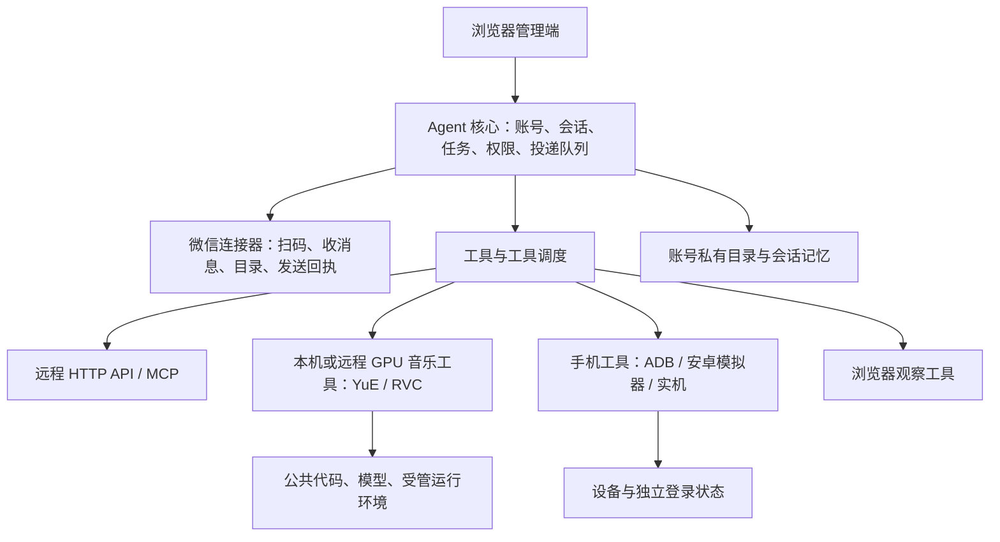

# 大肥鱼跨平台运行与镜像构建方案

更新时间：2026-10-28。**当前阶段只做本机源码运行、受管工作区改造和管理端改进，暂停构建、导出和发布镜像。** 本文是后续方案，不能把规划中的工具安装器、多架构支持或环境自修复视为已交付能力。

## 1. 当前实际情况

此前构建的是 **Linux / amd64 镜像**，不是 Windows 容器。Windows Docker Desktop 通过 WSL 2 等 Linux 虚拟化后端运行它；Linux 主机可使用 Docker Engine。镜像标签中的平台、宿主操作系统和浏览器所在平台是三个不同概念。[Docker Windows 安装说明](https://docs.docker.com/desktop/setup/install/windows-install/)、[WSL 后端](https://docs.docker.com/desktop/features/wsl/)

本项目目前的微信接入是已打补丁的 Linux 原生接入服务，网页提供扫码入口和状态管理。已验证保存的账号能够在无图形桌面的 Linux 服务中恢复登录并接收原生推送。**日常微信收发不要求同时运行 Linux 桌面、VNC 或安卓模拟器。** 这不代表所有视频分享、界面点击或未来的微信版本都无需 UI 适配。

Go 管理端可独立构建；完整产品能否在某平台运行，还取决于微信接入、隔离执行器、GPU 工具和手机驱动是否具备对应平台的运行环境。当前完整链路主要验证 Windows x64＋WSL 2 Ubuntu x86_64；不能将它宣传为 macOS/ARM64 已经开箱即用。

## 2. 推荐拆分：轻核心＋连接器＋可选工具

| 部分 | 推荐职责 | 推荐运行位置 | 更新方式 |
| --- | --- | --- | --- |
| 管理端＋Agent 核心 | 配置、会话、执行回合、持久任务、权限和有序投递 | 本机 WSL / Linux；后续可容器化 | 更新程序，保留数据 |
| 微信连接器 | 协议相关登录、目录、附件和回执 | 当前 Linux 服务 | 独立适配微信变化，不携带真实登录态 |
| 音乐工具 | 原曲换声、原创/相似歌曲、参考音频分析 | NVIDIA GPU 本机或远程 Worker | 工具源码和运行环境分别版本化 |
| 语音/图片/视频 API | ASR、TTS、识图、生成 | 服务商 API 或远程 Worker | 配置接口和密钥，通常无需更新核心 |
| 手机工具 | 点击、滑动、截屏、下载、打开 App | 有硬件虚拟化的主机或实体安卓机 | 设备驱动和动作适配独立更新 |
| 浏览器工具 | 网页读取、截图、公开链接观察 | 本机或远程浏览器 Worker | 浏览器版本和适配独立维护 |

本机已恢复 WSL 原生服务、网页和自动回复；音乐桥已在 WSL Bubblewrap 中启动，CUDA 张量、私有 Socket 与 YuE 节点发现检查通过。RVC 另用合成短音频完成了沙箱内真实模型转换。整首生成、音质、多账号 GPU 并发仍需另外验收。

本机当前可把核心和微信连接器作为两个后台进程运行，不必为了拆分而增加多个虚拟机。未来核心镜像也可以先打包这两个轻服务，保留接口边界；音乐和手机始终按需部署。

## 3. 手机模拟器与现有微信后台怎样组合

推荐**后台消息链路为主、按需调用界面操作为辅**。普通聊天、群目录、附件投递走当前连接器；只有需要实际打开 App、看页面、滑动、截屏或获取界面资源时，才调度手机/浏览器工具。观察结果带上原消息、账号、时间、来源、画面及音轨证据，回传原会话，不另开一套聊天记忆。

安卓模拟器运行在宿主支持的虚拟化环境，工具通过 ADB 等设备接口控制。不要默认把整个 Android 系统塞入核心 Docker 镜像；模拟器依赖 GPU、虚拟化和设备镜像，普通云主机或嵌套虚拟机不一定满足条件。Android 官方说明加速运行需要兼容的 Hypervisor，并且要核对其他虚拟化软件的兼容性。[Android Emulator 加速文档](https://developer.android.com/studio/run/emulator-acceleration)

设备身份单独登记：设备 ID、平台、连接状态、关联账号、已安装 App、操作授权和当前占用任务。微信桌面侧与手机侧能否同时登录、某机型/模拟器能否登录和观看，均需实测，不通过共享登录数据库或承诺“所有模拟器必定可用”解决。已有微信后台登录不意味着安卓微信已经授权登录。

一个设备同一时间由一个 UI 任务占用，防止并发点击串任务；后台接收消息可以继续。截图和下载落在请求账号的私有工作区，设备连接凭证由可信工具服务保存，不给普通聊天执行器。

## 4. 工具大全怎样做才有用

管理端保留一个“扩展能力”入口，按音乐、语音、视觉、网页、手机、自动化分类。默认展示“已安装、可用、运行中、需配置、异常”，点开才显示高级参数，避免各页面重复配置同一 Key、音色和项目路径。

工具有两层声明：

1. **工具契约**：名称、用途、输入 JSON Schema、返回值、取消方式、进度和任务 ID。通过 function calling/MCP 按需发现，不每轮塞入全部说明。
2. **运行清单**：工具版本、系统/架构、依赖锁定、资源 SHA-256、安装目录、入口、健康检查、CPU/GPU 需求、需要的权限、输入输出约定。

远程工具优先 HTTP API 或 MCP Streamable HTTP；本地轻工具可用 MCP stdio。MCP 提供连接和调用契约，**不负责替我们安装 CUDA/模型，也不自动赋予隔离权限**。[MCP 官方 SDK](https://ts.sdk.modelcontextprotocol.io/)

可信工具安装器负责下载、校验和启动服务。普通成员只能调用被提供的功能；管理员可管理公共项目。Agent 改工作区内代码与修改核心身份认证、密钥、权限控制是不同能力。stdio 工具会以所在服务的权限运行，不能把它当作普通群友任意执行宿主程序的通道。

当前已有 API/MCP 声明式工具与本机音乐接口；统一资源安装、签名/版本管理、设备调度和完整工具市场仍是待做项。不要把“导入 JSON”描述为已经自动安装整个项目。

## 5. 仓库拉取后的初始化流程

目标命令为 `git clone` 后执行平台对应的 `setup` / `doctor` / `start`。**这组统一的一键安装入口尚未完整实现；本机已有启动器只恢复已安装的环境。** 后续按下面顺序落地：

1. 检测 OS、架构、存储路径、可用空间、端口、WSL/命名空间、GPU；仅检查项目已知位置，不递归搜索所有磁盘。
2. 建立私有控制目录、`public_workspace` 和按账号隔离的 `pri_workspace`；运行数据与源码分开。
3. 编译或获取经过校验的 Go 核心与 Linux 原生微信组件。固定上游 revision、补丁哈希、编译工具版本和依赖锁。
4. 安装基础 FFmpeg/FFprobe、Python 和 Bubblewrap；执行最小隔离读写、越界拒绝、环境变量清理及子进程取消测试。
5. 启动本机网页。用户设置管理员密码和模型 Key，再授权微信扫码登录。源码中不携带别人电脑的认证数据。
6. 音乐、手机、其他生成能力按需安装；检测旧环境时允许登记复用，不自动重新下载全部模型。
7. 资源使用 staging 安装、哈希校验和原子切换，失败可回滚；完成后登记版本。升级程序不覆盖账号配置、真实消息、模型与生成物。

Linux 的 Python 环境建议存放在 Linux 原生文件系统；Windows 挂载盘上大量小文件的导入明显更慢。统一工作区可直接建立在 Linux 存储根，不用外部软链接穿透隔离边界。

本机入口：根目录 `启动大肥鱼.vbs`；命令行兼容 `启动大肥鱼.bat`。本机 WSL 实例和私有数据根从忽略 Git 的 `secrets/local-deployment.json` 读取，显式启动参数可覆盖。此文件不包含 API Key。

## 6. 新机器的环境清单

| 运行范围 | 环境 |
| --- | --- |
| Windows 本机基础聊天 | Windows 10/11 x64（具体 WSL 兼容性按系统检测）；启用硬件虚拟化、WSL 2、Ubuntu；浏览器；模型 API；不要求 Docker Desktop |
| Linux 本机/服务器基础聊天 | 建议 Ubuntu 22.04/24.04 x86_64；systemd 或等效监督器；可用的非特权命名空间和 Bubblewrap；FFmpeg/FFprobe、Python 3；浏览器可在其他电脑 |
| 从源码构建 | Git；Go 1.25.x（本项目 toolchain 1.25.3）；原生组件对应锁定 Rust 工具链与 Cargo.lock；C/C++ 编译工具；Node.js 用于前端语法/测试；Python 用于检查脚本 |
| 音乐推理 | 可用 NVIDIA 驱动、对应平台 Torch/CUDA ABI、独立 Python 环境、YuE/RVC/分离模型与受管清单。Windows Python 包不能直接给 WSL/Linux 使用 |
| 手机观察 | Android SDK Platform Tools / ADB；Android Emulator 与匹配 AVD、受支持 Hypervisor 或实体安卓机；设备侧 App 及其独立授权登录 |
| 未来容器部署 | Linux Docker Engine＋Compose，或 Windows/macOS 的 Linux 容器后端；GPU 工具另核对 GPU 容器支持 |

容量建议是规划起点，**不是已跑过压测的最低配置**：仅核心/API 聊天可先以 2–4 核、4–8 GB 内存、20 GB 以上可用 SSD 评估，历史消息与媒体另计；本机加模拟器建议 16 GB 以上内存。音乐应按具体模型/时长/显存实测，建议预留数十 GB 独立资源空间。当前一次 Linux 音乐依赖层已约 10.5 GB，尚未包含所有模型，不能按主程序大小估算音乐环境。本机已有 GPU 不代表 2–4 GB 无 GPU 云机可以生歌。

macOS 可先作为浏览器和远程核心客户端；完整本地接入、ARM64 原生组件、音频包和 GPU 后端没有验收前，不承诺一键安装。amd64 镜像在 ARM 主机上可能依赖仿真，尤其不适合据此承诺 GPU 音乐性能。

## 7. 后续镜像方案（暂停执行）

优先出 `linux/amd64`，后续只有对应组件编译、隔离及真实登录验收通过才加入 `linux/arm64`。不维护 Windows 容器来承载 Linux 微信组件。

- 核心镜像：管理端、Agent、轻量微信组件与必要媒体工具；固定版本和平台，提供健康检查。
- 音乐镜像：可选独立 Worker，固定 Python/Torch/CUDA ABI。公共模型外置；每个 Worker 只取得必要账号的输入输出。
- 手机工具：驱动可容器化，但模拟器/实机按设备环境部署，不挂载宿主 Docker Socket，也不默认使用 privileged。
- 程序、运行环境/模型、用户数据三层分开更新。镜像不会保存 Key、Cookie、登录态和真实聊天。
- 镜像更新先排空在途任务、备份、换版本、检查健康和原生在线，再恢复处理；失败保留旧镜像和数据回滚。只更新镜像也不能代替模型资源与数据库迁移的版本管理。

本仓库已有 `deploy/docker/` 和容器辅助脚本作为后续参考。本阶段不继续构建/导出镜像，不以已有镜像标签代表本机正在使用的程序版本。历史 Docker 运行文档保留，但入口应先指向本方案，避免误启动第二个同账号实例。

## 8. 当前改造的完成判断

分别验收：本机启动与健康、保存登录恢复、单账号和多账号边界、真实文件取得、跨群目标回执、语音手机播放、音乐沙箱兼容、设备实际观察、管理端交互。静态测试、模拟发送、服务端接受和手机实收不能混为一谈。

先完成本机账号/会话隔离和跨会话媒体链路，再统一扩展管理页与运行状态。完整新机安装和多架构镜像属于后续交付阶段，不以“写好方案”冒充运行验证。
